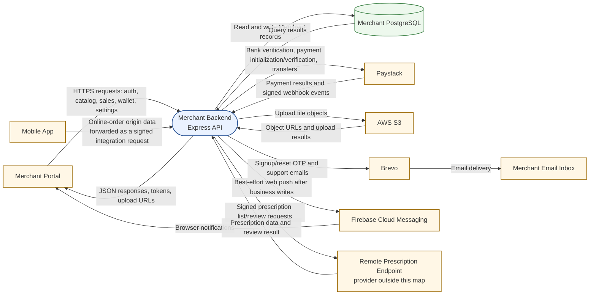
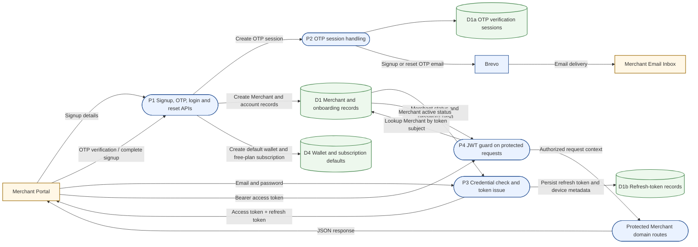
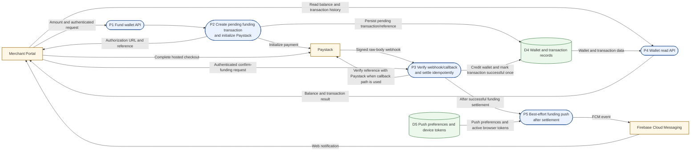
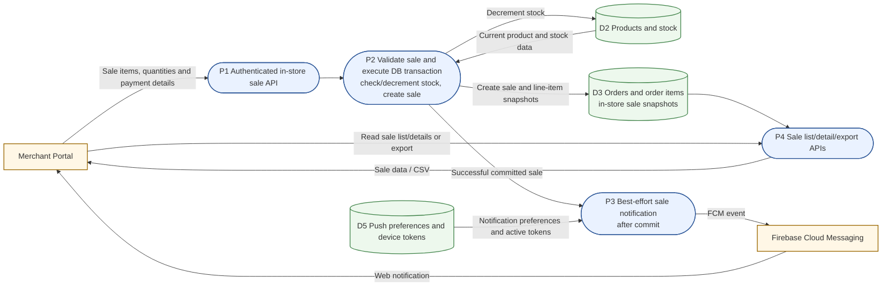

# Merchant Backend Data-Flow Map

This document maps runtime data flows through the Merchant backend as currently implemented. It is intended for both a project presentation and engineering handoff. The editable companion is [`merchant-data-flow-map.drawio`](./merchant-data-flow-map.drawio).

## Scope and notation

- The **Merchant Portal** and **Mobile App** are external data sources/consumers. “Mobile App” identifies the origin of online orders; the upstream forwarding mechanism is outside this map. Merchant receives those orders at its signed internal order-reflection endpoint.
- Paystack, AWS S3, Brevo, Firebase Cloud Messaging (FCM), and a remote prescription endpoint are shown only as external boundaries. Their internal processing is not mapped. The remote prescription endpoint is unnamed because Merchant proxies prescription list/review calls rather than owning that data.
- Merchant PostgreSQL stores are grouped by business domain. Arrows show the important data exchanged, not every request field or endpoint.
- DFD shapes: square-corner box = external entity; rounded box = process; cylinder = data store.

## Context DFD — Level 0



**Boundary note:** the Mobile App is the business origin shown for online orders. The label does not assert that the app itself signs the internal request; Merchant’s endpoint requires the configured signed integration request, while the upstream forwarding path is intentionally outside scope.

## Merchant-wide DFD — Level 1

```mermaid
flowchart LR
  portal[Merchant Portal]
  mobile[Mobile App]
  api([P1 API routing and request handling])
  jwt([P2 JWT validation<br/>on protected routes])
  internal([P3 Internal HMAC validation<br/>timestamp, nonce, replay check])
  auth([P4 Public auth APIs<br/>signup, OTP, login, reset])
  onboarding([P5 Merchant onboarding and profile])
  catalog([P6 Products, taxonomy and discounts])
  orders([P7 Online order reflection and management])
  prescriptions([P8 Prescription list/review proxy])
  sales([P9 In-store sales])
  finance([P10 Wallet and subscriptions])
  settings([P11 Settings and notification devices])
  upload([P12 File upload])
  reporting([P13 Dashboard, analytics and exports])
  support([P14 Support requests])
  paystackWebhook([P15 Paystack webhook signature check])
  accounts[(D1 Accounts and onboarding<br/>Merchant, verification, store, payment details])]
  catalogStore[(D2 Catalog<br/>products, global categories, discounts])]
  commerce[(D3 Orders and sales<br/>orders and order items])]
  financeStore[(D4 Finance<br/>wallets, transactions, plans, subscriptions])]
  preferences[(D5 Settings and devices<br/>preferences and FCM tokens])]
  paystack[Paystack]
  s3[AWS S3]
  brevo[Brevo]
  fcm[Firebase Cloud Messaging]
  prescription[Remote Prescription Endpoint]

  portal -->|Portal API requests| api
  api -->|Public auth routes| auth
  api -->|Public plan listing| finance
  api -->|Routes protected by JWT| jwt
  api -->|Upload routes (route-specific access)| upload
  jwt -->|Onboarding routes only| onboarding
  jwt --> catalog
  jwt --> orders
  jwt --> prescriptions
  jwt --> sales
  jwt --> finance
  jwt --> settings
  jwt --> reporting
  jwt --> support
  upload -->|File bytes| s3
  s3 -->|Stored object URL| upload
  upload -->|Upload result / URL| portal

  mobile -->|Order-origin data| internal
  internal -->|Validated signed request| orders
  prescriptions -->|Signed list/review calls| prescription
  prescription -->|Prescription list/review response| prescriptions
  paystack -->|Webhook request| paystackWebhook
  paystackWebhook -->|Verified event| finance
  finance -->|Payment/subscription initialization, verification and transfers| paystack
  paystack -->|Payment, subscription and transfer results| finance
  paystack -->|Bank verification results| onboarding
  settings -->|Payment-setting bank verification| paystack
  paystack -->|Bank verification results| settings

  auth --> accounts
  onboarding --> accounts
  auth -->|Create wallet / assign free plan on signup| financeStore
  auth -->|OTP/reset email| brevo
  onboarding -->|Bank account verification| paystack
  catalog --> catalogStore
  orders --> commerce
  catalogStore -->|Current product and stock data| sales
  sales -->|Update stock| catalogStore
  sales --> commerce
  finance --> financeStore
  settings --> preferences
  catalog -.->|Startup taxonomy sync and legacy-category backfill| catalogStore
  catalogStore -->|Catalog data for metrics| reporting
  commerce -->|Order/sales data for metrics| reporting
  financeStore -->|Finance data for metrics| reporting
  support -->|Support request and confirmation email| brevo
  settings -->|Save settings and token registrations| preferences
  preferences -->|Push preferences and active device tokens| settings
  orders -->|After successful new-order commit| settings
  sales -->|After successful sale commit| settings
  finance -->|After successful funding settlement| settings
  settings -->|Eligible event payloads| fcm
  fcm -->|Web push| portal
  accounts --> auth
  accounts --> jwt
  catalogStore --> catalog
  commerce --> orders
  commerce --> sales
  financeStore --> finance
  preferences --> settings

  classDef external fill:#fff7e6,stroke:#9a6700,stroke-width:1.5px;
  classDef process fill:#eaf2ff,stroke:#315a9a,stroke-width:1.5px;
  classDef store fill:#edf8ed,stroke:#41844a,stroke-width:1.5px;
  class portal,mobile,paystack,s3,brevo,fcm,prescription external;
  class api,jwt,internal,auth,onboarding,catalog,orders,prescriptions,sales,finance,settings,upload,reporting,support,paystackWebhook process;
  class accounts,catalogStore,commerce,financeStore,preferences store;
```

### Route and persistence notes

- The API base path is `/api/v1/merchant`. Authentication is applied per route group/route; do not infer that every endpoint uses the same guard. The internal order routes use HMAC authentication plus a rate limiter. The Paystack webhook is unauthenticated by JWT but verifies Paystack’s signature using the captured raw request body.
- Signup/login/OTP and upload endpoints have their own route behavior; onboarding and Merchant-domain routes use JWT protection. Subscription plans are public, while subscription operations apply JWT per route.
- Category data is platform-wide: the JSON taxonomy is synchronized into PostgreSQL at startup, with legacy product category backfill. Merchants select categories; they do not manage the global taxonomy.
- Uploaded files are put into S3 and the URL is returned. Portal/onboarding or catalog requests can then persist that URL as a business record.
- Prescription list/review endpoints proxy requests to a remote endpoint; prescription records are not shown as a Merchant-owned database store here.
- Dashboard and analytics are query paths over existing catalog, order/sales, and finance stores rather than separate primary business stores.

## Detailed flow A — Authentication and portal access



Signup first stores and emails an OTP session; after OTP verification, signup completion creates the Merchant and related defaults. Login issues an access token and persisted refresh token. The JWT middleware checks the token and confirms the Merchant is active before attaching the Merchant identity to the request context.

## Detailed flow B — Online order received from the Mobile App

```mermaid
flowchart LR
  mobile[Mobile App<br/>order origin]
  gate([P1 Signed internal order endpoint<br/>HMAC, timestamp, nonce, replay/rate checks])
  reflect([P2 Validate and reflect order<br/>idempotency by source IDs])
  orders[(D3 Drugstore orders)]
  items[(D3a Order items<br/>product and price snapshots])
  portal[Merchant Portal]
  list([P3 Merchant order list/status APIs])
  notify([P4 Best-effort order push])
  prefs[(D5 Push preferences and device tokens)]
  fcm[Firebase Cloud Messaging]

  mobile -->|Order-origin data; forwarded signed request enters Merchant| gate
  gate -->|Authenticated payload| reflect
  reflect -->|Create order in DB transaction| orders
  reflect -->|Create item snapshots| items
  orders -->|Order appears in merchant queue| list
  items -->|Order details| list
  portal -->|List orders / update status| list
  list -->|Order data and status result| portal
  reflect -->|Only after a newly created order commits| notify
  prefs -->|Push preferences and active browser tokens| notify
  notify -->|FCM message| fcm
  fcm -->|Web notification| portal

  classDef external fill:#fff7e6,stroke:#9a6700,stroke-width:1.5px;
  classDef process fill:#eaf2ff,stroke:#315a9a,stroke-width:1.5px;
  classDef store fill:#edf8ed,stroke:#41844a,stroke-width:1.5px;
  class mobile,portal,fcm external;
  class gate,reflect,list,notify process;
  class orders,items,prefs store;
```

Merchant stores the supplied payment status/reference and product snapshots; this reflection flow does not itself charge the buyer or independently verify the originating checkout payment. Replayed/idempotent order reflection does not create another order or send a duplicate push.

## Detailed flow C — Wallet funding



The webhook path verifies the Paystack signature over the raw body. The authenticated confirmation path verifies the payment with Paystack. Both converge on idempotent settlement; push delivery is attempted after settlement and does not undo a credited wallet if FCM fails.

## Detailed flow D — Offline/in-store sale



Stock changes and sale/order-item writes occur in one database transaction. The notification is sent afterward as best-effort work; a push failure does not roll back the recorded sale.

## Detailed flow E — Push-notification setup and delivery

```mermaid
flowchart LR
  portal[Merchant Portal Browser]
  setup([P1 Register browser FCM token<br/>and save notification settings])
  prefs[(D5 Merchant settings<br/>preferences and device tokens])
  event([P2 Committed business event<br/>new order, wallet funded, offline sale])
  dispatch([P3 Check global/event preference<br/>load active device tokens])
  fcm[Firebase Cloud Messaging]
  worker([P4 Browser service worker<br/>display notification])

  portal -->|FCM token, device ID, preferences| setup
  setup -->|Persist / update registration and preferences| prefs
  event -->|Merchant ID and event payload| dispatch
  prefs -->|Preference and active device tokens| dispatch
  dispatch -->|Notification title/body and string data| fcm
  fcm -->|Web push delivery| worker
  worker -->|Display notification / click navigation| portal
  portal -->|Push status or test notification request| setup

  classDef external fill:#fff7e6,stroke:#9a6700,stroke-width:1.5px;
  classDef process fill:#eaf2ff,stroke:#315a9a,stroke-width:1.5px;
  classDef store fill:#edf8ed,stroke:#41844a,stroke-width:1.5px;
  class portal,fcm external;
  class setup,event,dispatch,worker process;
  class prefs store;
```

The browser first obtains permission and an FCM registration token, then registers the token and preferences with Merchant. Order reflection, successful wallet funding, and offline-sale creation trigger push attempts after the business record is committed. Global/event preferences, missing devices, or missing Firebase configuration can skip delivery. Push is best-effort and is not the system of record for these events.

## Source checks

The diagrams were checked against the current Merchant implementation, including:

- [Route registration](../merchant/src/core/routes.ts) and [database startup/models](../merchant/src/core/db.ts)
- [JWT middleware](../merchant/src/middlewares/Auth.Middleware.ts) and [internal HMAC middleware](../merchant/src/middlewares/internal-auth.middleware.ts)
- [Order reflection](../merchant/src/modules/drugstore_internal/DrugstoreInternal.service.ts), [wallet settlement](../merchant/src/modules/wallet/Wallet.service.ts), and [in-store sales](../merchant/src/modules/in_store_sales/InStoreSale.service.ts)
- [FCM delivery](../merchant/src/service/Firebase/FirebaseMessaging.service.ts), [S3 uploads](../merchant/src/modules/upload/Upload.service.ts), [Paystack integration](../merchant/src/service/Paystack/Paystack.service.ts), and [email delivery](../merchant/src/service/Email/Email.service.ts)
- [Prescription proxy](../merchant/src/modules/drugstore_prescriptions/DrugstorePrescription.service.ts)
